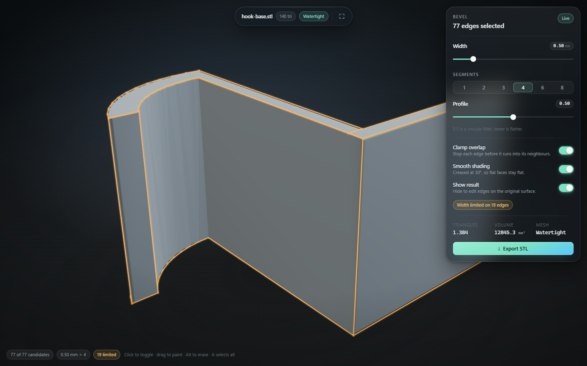

# Bevel Studio

A local-first STL bevel editor. Drop in a printable model, let it find the
bevelled-able edges, refine the selection by clicking or painting, dial in a
fillet, and export a watertight STL — without opening Blender.



## Run it

```bash
npm install
npm run dev        # http://localhost:5183
```

Production build: `npm run build` (static `dist/`).

### Desktop app (Tauri)

```bash
npm run tauri build
```

Installer: `src-tauri/target/release/bundle/nsis/Bevel Studio_0.1.0_x64-setup.exe`.
`npm run tauri dev` opens the desktop shell against the dev server.

Prerequisites (already installed on this machine): Node 26, Rust stable with the
MSVC toolchain, Visual Studio Build Tools (C++ workload), WebView2 runtime.

## What works

- **Import** — binary or ASCII STL, millimetres, origin preserved. Repair pipeline
  welds at 1e-4 mm, fixes winding, drops duplicate/degenerate faces, fills holes
  up to 64 edges, removes tiny disconnected shells.
- **Edges** — canonical edge table with dihedral angle, convexity, per-edge
  `maxWidth`, and auto-detected candidates (convex, ≥ 20°).
- **Selection** — left-click adds an edge, right-click removes it, drag paints the
  same value, middle-drag pans, wheel zooms, `A` selects all candidates,
  `Ctrl+Z` / `Ctrl+Shift+Z` undo and redo, `F` refits. A permanent legend sits at
  the bottom of the viewport.
- **Bevel** — width, segments, profile, per-edge clamp, live preview in a worker.
  The bevel is a real boolean of the rolling-ball cut solid, so flap faces and
  runaway edges are structurally impossible.
- **Export** — binary STL, same units and origin as the input.

## Reference acceptance

`npm run acceptance` bevels `public/fixtures/hook-base.stl` with the same kernel
the app uses and compares it with the model that was hand-made in Blender:

| | triangles | volume | bbox (mm) |
|---|---|---|---|
| source | 140 | 12 871.80 | 47.88 × 62.15 × 35.00 |
| hand-made reference | 654 | 12 788.47 | 47.88 × 61.87 × 35.00 |
| **tool, all convex edges** | 2 686 | **12 782.60** (−0.05 %) | **47.88 × 61.92 × 35.00** |

The tool lands within 0.05 % of the reference volume and 0.05 mm on the
bounding box. It keeps roughly 4× more triangles because CSG retriangulates
the trimmed faces; the shape, not the tessellation, is the acceptance criterion.
`npm run acceptance` asserts those windows and exits non-zero when the shape
drifts, so it can gate a release.

## Known issue: crossings at tight corners

Beveling **all** convex edges also bevels the under-table plate, whose corners
are too tight for the current corner handling: the result can contain
self-intersecting triangles. The kernel detects them (`bevel.selfIntersection`),
marks the result not watertight, and the Inspector blocks export rather than
shipping broken geometry. The outside-rim selection is clean and is asserted at
zero crossings by `npm run acceptance`.

Until the clamp is made chain-consistent (adjacent cuts sharing one radius),
deselect the four plate-corner edges before exporting.

## Architecture

```
src/
  engine/        pure TypeScript, no DOM, no three.js
    io/stl.ts        parse + weld
    repair/          R1–R8 repair pipeline
    topo/            canonical edge table, union-find, Euler metadata
    bevel/           cut-solid construction, Manifold WASM boolean, STL writer
    worker.ts        owns the source mesh; import/preview/export jobs
    client.ts        main-thread façade, latest-wins preview
  viewport/      three.js scene, edge overlay, picking, selection gestures
  panels/        inspector, top bar, status bar
  ui/            glass component kit + gallery at /?gallery=1
  state/         zustand store, engine singleton, live preview, export
```

Performance, measured with `npm run bench` (1,080,000-triangle cube, 51.5 MB STL)
and `node tools/e2e-1m.mjs` (same file through the browser):

| stage | Node | browser |
|---|---|---|
| parse + weld (2.16 M raw verts → 540 k) | 1.18 s | 7.57 s (whole import) |
| repair + edge table (1.62 M edges) | 3.64 s | — |
| bevel 400 edges (incl. boolean + cleanup) | 3.97 s | — |
| first rendered frame after import | — | **7 ms** |
| hook (140 tris), bevel | 47 ms | — |

Above 300 k triangles the viewport switches to flat shading (facet normals in the
shader) instead of merging creased normals, which is what keeps the first frame
instant. The 1 M import is dominated by the worker's repair pass.

## Not done yet

- Loop/ring and silhouette-sweep selection (click/paint is implemented).
- Concave-edge bevels (rejected with a warning by design).
- A BVH for pointer picking: raycasts are linear in triangle count, so painting
  on a 1 M-triangle mesh is sluggish.
- Repeated-preview WASM heap measurement; the kernel frees temporaries but the
  Manifold heap itself is not tracked.

## Docs

- `PLAN.md` — the full product and geometry plan.
- `ORCHESTRATION.md` — workstream split, contracts and gates.
- `experiments/spike/report.json` — the kernel feasibility measurements.
